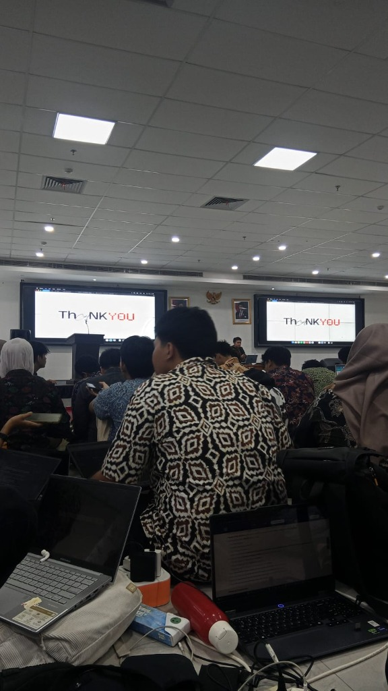

# Lokakarya Proyek Hari 1 - EXPECTIK 2026
### Himpunan Mahasiswa Informatika dan Komputer (HIMATIK) - Politeknik Negeri Jakarta

---

## 📌 Informasi Peserta
- **Nama Lengkap:** Delvin Athallah Fassah
- **Kelompok:** FC27
- **Tautan Repositori:** [Hari-1-FC27-Delvin-Athallah-Fassah](https://github.com/DelvinAthallah15/Hari-1-FC27-Delvin-Athallah-Fassah)
- **Kegiatan:** Lokakarya Proyek Hari 1 (EXPECTIK 2026)

---

## 📖 Deskripsi Singkat Repositori
Repositori ini disusun sebagai bentuk dokumentasi resmi serta pemenuhan penugasan **Lokakarya Proyek Hari 1** pada kegiatan **EXPECTIK 2026** yang diselenggarakan oleh Himpunan Mahasiswa Informatika dan Komputer (HIMATIK) Politeknik Negeri Jakarta. Repositori ini memuat ringkasan materi seputar integrasi teknologi Artificial Intelligence (AI) dalam pembuatan website/aplikasi, pemahaman dasar *Version Control System* menggunakan Git dan GitHub, wawasan baru yang diperoleh, serta opini dan evaluasi konstruktif terhadap pelaksanaan kegiatan.

---

## 🎯 Tujuan dan Kegunaan Repositori
Adapun tujuan dan kegunaan dari repositori ini adalah:
1. **Pemenuhan Tugas Resmi:** Memenuhi kriteria penugasan Lokakarya Proyek Hari 1 EXPECTIK 2026 sesuai dengan ketentuan teknis yang ditetapkan panitia HIMATIK PNJ.
2. **Penerapan Praktik Git & GitHub:** Mengaplikasikan alur kerja version control secara nyata, mulai dari inisialisasi repositori lokal, *staging*, pembuatan *commit*, hingga sinkronisasi daring (*push*) ke GitHub.
3. **Penyimpanan Dokumentasi Pembelajaran:** Mengarsipkan catatan dan intisari materi mengenai pemanfaatan AI untuk pembuatan aplikasi serta penggunaan perintah-perintah esensial Git.
4. **Referensi Portofolio Digital:** Menjadi rekam jejak pembelajaran mandiri yang rapi, terstruktur, dan dapat diakses kembali untuk mendukung proyek-proyek kolaboratif di masa mendatang.

---

## 📸 Dokumentasi Kegiatan
Berikut adalah dokumentasi kehadiran selama mengikuti rangkaian sesi Lokakarya Proyek Hari 1:

  
   
  <em>Gambar: Dokumentasi kegiatan Lokakarya Proyek Hari 1 EXPECTIK 2026 di ruangan seminar.</em>

---

## 📝 Dokumentasi Kegiatan Workshop

### 1. Rangkuman Materi yang Disampaikan Selama Workshop
Workshop Hari 1 membahas dua topik utama yang sangat krusial dalam dunia rekayasa perangkat lunak modern:
1. **Pemanfaatan Artificial Intelligence (AI) dalam Pembuatan Aplikasi & Website:**
   - AI dapat dioptimalkan sebagai asisten produktivitas dalam mempercepat perancangan antarmuka, pembuatan kerangka kode, hingga pencarian solusi atas permasalahan teknis (*debugging*).
   - Kunci keberhasilan implementasi AI terletak pada perumusan **prompt yang jelas, spesifik, dan berkonteks**, sehingga instruksi dapat dipahami dan diterjemahkan oleh model AI menjadi kode yang fungsional dan terstruktur.

2. **Pengenalan Version Control System (Git & GitHub):**
   - **Konsep Dasar:**
     - **Repository:** Ruang penyimpanan proyek tempat file dan seluruh riwayat perubahannya disimpan.
     - **Commit:** Rekaman status atau snapshot perubahan kode pada momen tertentu yang disertai pesan deskriptif.
     - **Branch:** Jalur kerja independen untuk mengembangkan fitur baru tanpa memengaruhi kode utama (*main*).
     - **Pull Request (PR):** Mekanisme pengajuan untuk menggabungkan kode dari suatu branch ke branch tujuan setelah melalui proses peninjauan (*code review*).
   - **Perintah Dasar Git yang Dipelajari:**
     - `git init`: Menginisialisasi repositori Git baru pada direktori lokal.
     - `git add`: Mendaftarkan perubahan file ke *staging area*.
     - `git commit -m "pesan"`: Menyimpan rekaman perubahan dari staging area ke repositori lokal.
     - `git push`: Mengunggah commit lokal ke repositori daring di GitHub.
     - `git pull`: Menarik dan menggabungkan pembaruan terbaru dari repositori daring ke repositori lokal.

---

### 2. Poin-Poin Penting atau Pengetahuan Baru yang Dipelajari
Beberapa wawasan penting dan pengetahuan baru yang diperoleh dari workshop ini meliputi:
- **Perbedaan Fundamental antara Git dan GitHub:**
  - **Git** berperan sebagai kakas (*tool*) pengendali versi yang beroperasi secara lokal untuk melacak setiap detail modifikasi pada proyek.
  - **GitHub** bertindak sebagai platform berbasis komputasi awan (*cloud*) yang menampung repositori Git, memungkinkan pencadangan proyek secara online serta memfasilitasi kolaborasi multipengembang secara global.
- **Pentingnya Prompt Engineering yang Terarah:**
  - Menyadari bahwa AI bukan pengganti pemahaman logika dasar, melainkan akselerator. Hasil keluaran AI sangat bergantung pada bagaimana kita menyusun prompt yang terstruktur (menyertakan konteks, batasan, spesifikasi teknis, dan tujuan yang ingin dicapai).
- **Pengelolaan Proyek yang Terstruktur:**
  - Memahami pentingnya pesan commit yang informatif serta pemisahan fitur menggunakan branch agar riwayat proyek tetap bersih, mudah dilacak, dan minim konflik (*merge conflicts*).

---

### 3. Pendapat Pribadi tentang Lokakarya Proyek Hari 1
- **Kelebihan dan Nilai Positif:**
  - Topik materi sangat relevan dan aplikatif bagi mahasiswa informatika, menjembatani teknologi masa kini (AI) dengan standar industri pengembangan perangkat lunak (Git & GitHub).
- **Evaluasi dan Kendala:**
  - Durasi penyampaian seminar dirasa terlalu panjang dan kurang langsung menyasar ke inti materi praktis, sehingga memerlukan fokus ekstra agar tidak jenuh.
  - Manajemen dan pengaturan waktu acara masih kurang teratur.
  - Rentang waktu pengumpulan penugasan workshop (*gultik*) berdekatan dengan jadwal penugasan perkuliahan reguler, sehingga cukup menantang dalam membagi alokasi waktu dan energi.
- **Saran Konstruktif untuk Sesi Berikutnya:**
  - Penyampaian materi sebaiknya dibuat lebih ringkas, padat, dan langsung mengedepankan sesi simulasi atau praktik langsung (*hands-on*).
  - Diharapkan panitia dapat menyusun *timeline* kegiatan dan tenggat waktu tugas yang lebih terukur serta mempertimbangkan kalender akademik mahasiswa, sehingga interaksi dan kerja sama antara audiens dan panitia dapat terjalin dengan lebih kondusif dan optimal.

---

  <b>EXPECTIK 2026 • HIMATIK Politeknik Negeri Jakarta</b>

